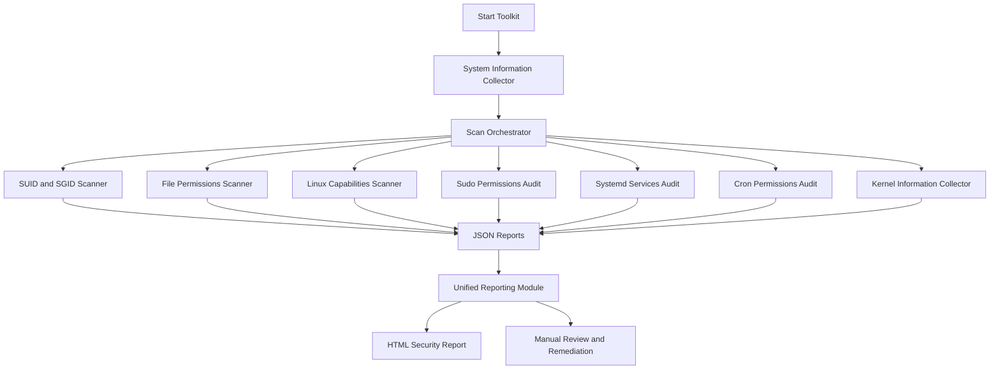

# Project Architecture

## 1. Overview

The Linux Privilege Escalation Automation Toolkit is a Python-based, detection-only security auditing tool. It collects selected Linux system information, checks selected configuration risks, and generates reports for manual review.

## 2. Architecture Flowchart

## 3. Main Components

- **Scan Orchestrator:** Runs the selected scanner modules.
- **System Collector:** Records operating system, kernel, architecture, and user details.
- **SUID/SGID Scanner:** Identifies selected files with special permission bits.
- **Permissions Scanner:** Checks selected locations for world-writable files.
- **Capabilities Scanner:** Collects available Linux file capabilities.
- **Sudo Audit:** Inspects the current user's sudo permissions without prompting for a password.
- **Services Audit:** Collects selected systemd service configuration information.
- **Cron Audit:** Checks selected cron locations for risky file permissions.
- **Kernel Collector:** Records kernel information. CVE matching is not implemented yet.
- **Reporting:** Combines supported findings and produces an HTML report.

## 4. Data Flow

1. The user starts the toolkit.
2. The orchestrator executes the selected scan modules.
3. Modules collect information and write individual JSON reports.
4. The reporting module combines supported findings.
5. The HTML generator presents results for manual review.

## 5. Safety Design

- Detection and reporting only.
- No exploitation or privilege escalation attempts.
- No execution of discovered SUID/SGID binaries.
- No intentional modification of system configuration.
- Findings require manual verification before remediation.

## 6. Limitations

The scanners cover selected paths and configurations, not every possible privilege escalation vector. Results can be incomplete, and findings are not proof of exploitability. Kernel CVE matching and comprehensive cron-script analysis remain future improvements.
